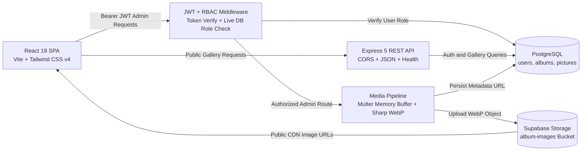
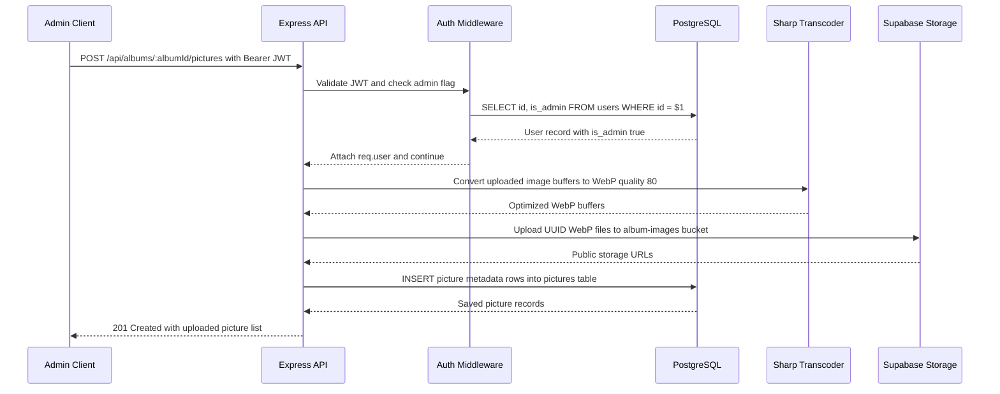
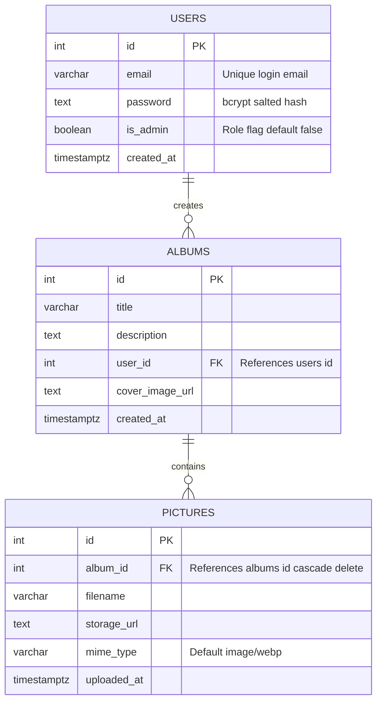

<div align="center">

# Full-Stack Auth & Media Gallery

**A full-stack JWT authentication, database-backed RBAC, and WebP cloud media gallery built with React 19, Express 5, PostgreSQL, and Supabase Storage.**

[](https://react.dev/)
[](https://vite.dev/)
[](https://tailwindcss.com/)
[](https://expressjs.com/)
[](https://www.postgresql.org/)
[](https://supabase.com/)
[](./LICENSE)

</div>

---

## System Architecture



### Admin Upload & Authorization Flow



### Database Schema



---

## Core Engineering Highlights

- **JWT Authentication + Live DB-Backed RBAC:** Passwords are salted and hashed with `bcryptjs` and sessions are signed with `jsonwebtoken`. Protected admin routes verify the Bearer JWT and re-query `is_admin` from PostgreSQL on every request so role revocations take effect immediately without waiting for token expiry.
- **Automated WebP Media Pipeline:** `multer` memory buffers pass through `sharp` to transcode cover images and multi-photo batch uploads (up to 10 files per request, 5 MB limit each) into optimized WebP assets before persisting to Supabase Storage under UUID keys.
- **Cascading Cloud & Relational Cleanup:** Deleting a single photo or an entire album removes both the relational PostgreSQL rows (`ON DELETE CASCADE`) and the corresponding object keys from Supabase Storage to prevent orphaned media files.
- **Environment-Driven Configuration:** All API endpoints, CORS allowlists, storage bucket names, PostgreSQL TLS/CA settings, and secrets are strictly externalized via `.env` variables with checked-in `.env.example` templates.
- **React Context Auth & Route Guards:** Centralized `AuthProvider` and `useAuth` hook hydrate sessions cleanly, attach Axios `Authorization` headers automatically, and guard `/admin` and `/admin/albums/:albumId` routes via `ProtectedRoute`.

---

## API Endpoints

| Method | Endpoint | Access | Description |
| :--- | :--- | :--- | :--- |
| `GET` | `/api/health` | Public | API liveness probe |
| `POST` | `/api/auth/signup` | Public | Register a new user and issue JWT |
| `POST` | `/api/auth/login` | Public | Authenticate credentials and issue JWT |
| `POST` | `/api/auth/logout` | Public | Acknowledge client-side token clearance |
| `GET` | `/api/albums` | Public | List all albums with aggregated photo counts |
| `GET` | `/api/albums/:albumId/pictures` | Public | List all pictures inside an album |
| `GET` | `/api/albums/:albumId` | Admin | Fetch single album metadata |
| `POST` | `/api/albums` | Admin | Create album with optional WebP cover upload |
| `POST` | `/api/albums/:albumId/pictures` | Admin | Batch upload up to 10 photos (WebP transcoded) |
| `DELETE` | `/api/albums/pictures/:pictureId` | Admin | Delete a single picture from DB and Supabase Storage |
| `DELETE` | `/api/albums/:albumId` | Admin | Cascade-delete album, pictures, cover, and cloud objects |

---

## Repository Structure

```text
fullstack-auth/
├── backend/
│   ├── config/
│   │   └── supabase.js             # Supabase Storage service-role client
│   ├── middleware/
│   │   └── authMiddleware.js       # JWT verification and DB-backed admin guard
│   ├── routes/
│   │   ├── auth.js                 # Signup, login, and logout endpoints
│   │   └── albumRoutes.js          # Gallery CRUD, Sharp WebP transcoding, storage cleanup
│   ├── .env.example                # Backend environment variable template
│   ├── package.json
│   ├── schema.sql                  # PostgreSQL DDL for users, albums, pictures
│   └── server.js                   # Express server, CORS, PostgreSQL pool, SSL config
├── frontend/
│   ├── src/
│   │   ├── components/
│   │   │   ├── AdminUpload.jsx     # Admin album creation and dashboard
│   │   │   ├── AlbumDetail.jsx     # Batch photo upload and deletion controls
│   │   │   ├── Home.jsx            # Public album grid and lightbox gallery
│   │   │   ├── Login.jsx           # User login form
│   │   │   ├── ProtectedRoute.jsx  # Authenticated route wrapper
│   │   │   └── Signup.jsx          # User registration form
│   │   ├── config/
│   │   │   └── api.js              # Centralized VITE_API_BASE_URL resolution
│   │   ├── context/
│   │   │   ├── AuthContext.jsx     # AuthProvider state and Axios auth header sync
│   │   │   └── useAuth.js          # Shared AuthContext and useAuth hook
│   │   ├── App.jsx                 # Router layout and navigation bar
│   │   └── main.jsx                # React root bootstrap
│   ├── .env.example                # Frontend environment variable template
│   ├── eslint.config.js
│   ├── package.json
│   └── vite.config.js
├── .gitignore
├── LICENSE
└── README.md
```

---

## Local Setup & Execution

### Prerequisites
- **Node.js** 20+ and **npm**
- A **PostgreSQL** database (local or hosted, e.g., Supabase Postgres)
- A **Supabase** project with a public Storage bucket (default: `album-images`)

### 1. Clone the Repository
```bash
git clone https://github.com/theekshana-sudeepa/fullstack-auth.git
cd fullstack-auth
```

### 2. Initialize PostgreSQL Schema
Run [backend/schema.sql](./backend/schema.sql) against your PostgreSQL database:
```bash
psql "$PG_CONNECTION_STRING" -f backend/schema.sql
```
To grant admin privileges to a registered account:
```sql
UPDATE users SET is_admin = TRUE WHERE email = 'admin@example.com';
```

### 3. Configure & Run Backend
```bash
cd backend
cp .env.example .env
# Edit .env with your PostgreSQL connection string, JWT secret, and Supabase credentials
npm install
npm start
```
The API runs on `http://localhost:5001` by default.

### 4. Configure & Run Frontend
```bash
cd frontend
cp .env.example .env
# Ensure VITE_API_BASE_URL points to http://localhost:5001/api
npm install
npm run dev
```
Open `http://localhost:5173` in your browser.

### Verification Commands
```bash
# Frontend lint and production build
cd frontend && npm run lint && npm run build
```

---

## License

This project is licensed under the **MIT License** — see [LICENSE](./LICENSE) for details.

---

<div align="center">

**Built by Theekshana Sudeepa**

[LinkedIn](https://www.linkedin.com/in/theekshana-sudeepa/) · [GitHub](https://github.com/theekshana-sudeepa) · [LexoraTech](https://lexoratech.com)

</div>
